# 🎫 BookMyTicket — Full-Stack Travel & Ticketing Platform

A full-stack travel reservation application that brings **Flights, Trains, Buses, and Hotels** together in one platform. Built with **Java, Spring Boot, React, and MySQL**, featuring JWT-based authentication, role-based access control, booking management, and an administrative dashboard.

🌐 **[Live Application](https://bookmyticket-seven.vercel.app/)** · **[Backend API](https://book-my-ticket-qwng.onrender.com/)**

## 📌 Table of Contents

- [Overview](#-overview)
- [Live Demo](#-live-demo)
- [Technology Stack](#-technology-stack)
- [Features](#-features)
- [Application Screenshots](#-application-screenshots)
- [Architecture](#-architecture)
- [Configuration and Deployment](#-configuration-and-deployment)
- [Run Locally](#-run-locally)
- [Author](#-author)

## 🌐 Live Demo

| Component | Platform | Link |
|---|---|---|
| Frontend | Vercel | [Open BookMyTicket](https://bookmyticket-seven.vercel.app/) |
| Backend REST API | Render | [Open Backend](https://book-my-ticket-qwng.onrender.com/) |
| Database | Aiven Cloud | Managed MySQL 8.0 |

> **Deployment note:** The backend runs on Render's free tier and may experience a cold start after inactivity. The first request can take approximately 45–60 seconds to respond.

## 🛠️ Technology Stack


### Backend

- **Language:** Java (JDK 27)
- **Framework:** Spring Boot (4.1.2)
- **Security:** Spring Security, JWT authentication, BCrypt password hashing, and role-based authorization
- **Persistence:** Spring Data JPA, Hibernate ORM, MySQL Connector/J, and HikariCP
- **API design:** REST controllers, DTOs, Jakarta Bean Validation, and global exception handling
- **Build:** Maven Wrapper

### Frontend

- **Framework:** React
- **Build tool:** Vite
- **Routing:** React Router DOM
- **State management:** React Context API
- **HTTP client:** Axios with centralized configuration and JWT bearer-token interceptors
- **Styling:** CSS modules organized by feature and component

### Database and DevOps

- **Database:** MySQL 8.0 on Aiven Cloud
- **Containerization:** Multi-stage Docker build
- **Backend hosting:** Render
- **Frontend hosting:** Vercel
- **Configuration:** Environment variables for sensitive deployment settings

## ✨ Features

### 🔐 Authentication and Authorization

- Customer registration and login through REST API endpoints.
- Stateless JWT-based authentication.
- Password hashing with `BCryptPasswordEncoder`.
- Separate `ADMIN` and `CUSTOMER` roles.
- Protected administrative inventory operations.
- CORS configuration for the deployed frontend and local development.

### ✈️ Multi-Modal Travel Inventory

**Flights**
- Flight information, airline details, routes, departure schedules, fares, and seat availability.
- Support for intermediate stops through the `FlightStop` model.

**Trains**
- Train details, station schedules, routes, and seating classes.
- Search functionality based on origin, destination, and travel date.

**Buses**
- Bus fleet information, routes, departure schedules, fares, and seat availability.
- Configurable boarding and dropping points.

**Hotels**
- Hotel properties, room configurations, and date-based room inventory.
- Search based on destination, check-in date, and check-out date.

### 🎟️ Booking and Payment Management

- Dedicated booking modules for flights, trains, buses, and hotels.
- Booking status and payment status tracking.
- Payment method and booking type management.
- Customer booking history and reservation details.
- Centralized transaction records across booking categories.

### 📊 Customer and Admin Dashboards

**Customer portal**
- Browse travel categories and search for available options.
- Review travel and accommodation details.
- Access booking history and reservation status.
- Manage customer profile information.

**Admin portal**
- View platform metrics, booking counts, and revenue summaries.
- Manage flight, train, bus, and hotel inventory.
- Review bookings and transaction records.
- Access category-wise booking and revenue summaries.

## 📸 Application Screenshots

### 🔐 Authentication

The login and registration interface provides the entry point to the platform.

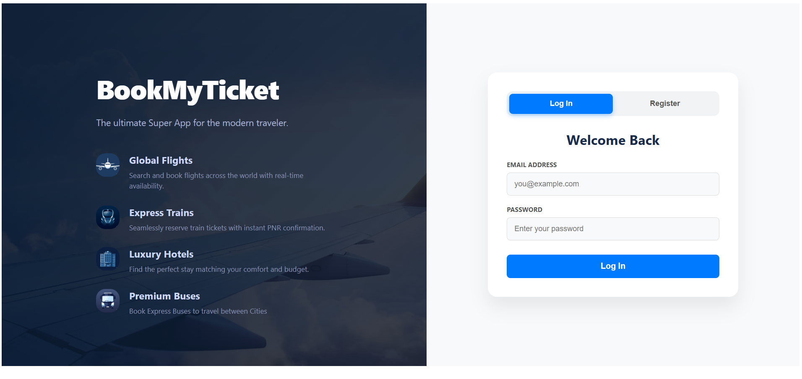

### 👤 Customer Portal

#### Home Page

A unified interface for accessing all four travel categories.

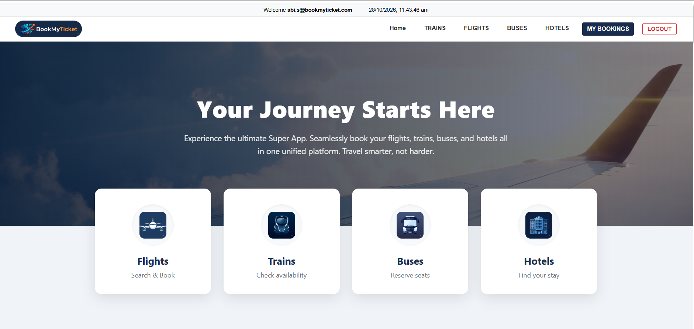

#### Train Search

Search trains by source, destination, and travel date.

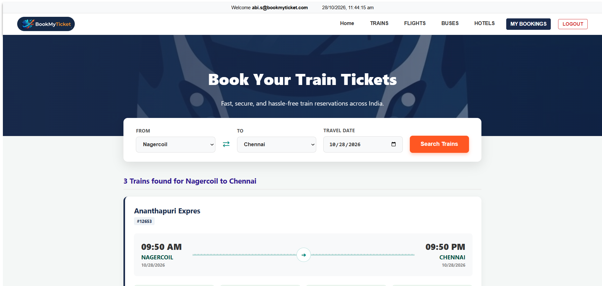

#### Flight Search

Explore flight options and journey details.

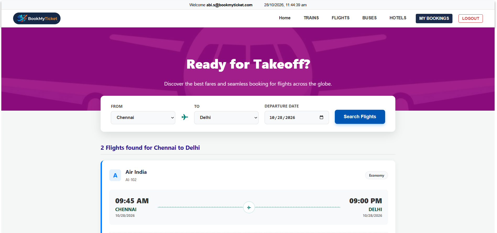

#### Bus Search

Review available bus services, routes, departure times, and fares.

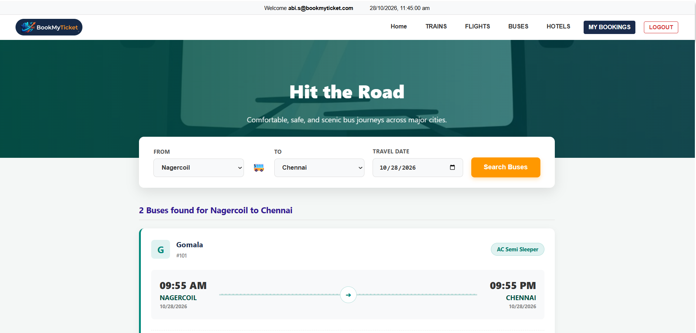

#### Hotel Search

Explore hotel details, room options, and availability.

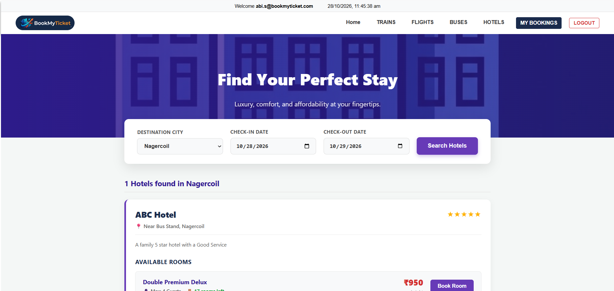

#### My Bookings

View reservations, journey information, booking status, and payment details.

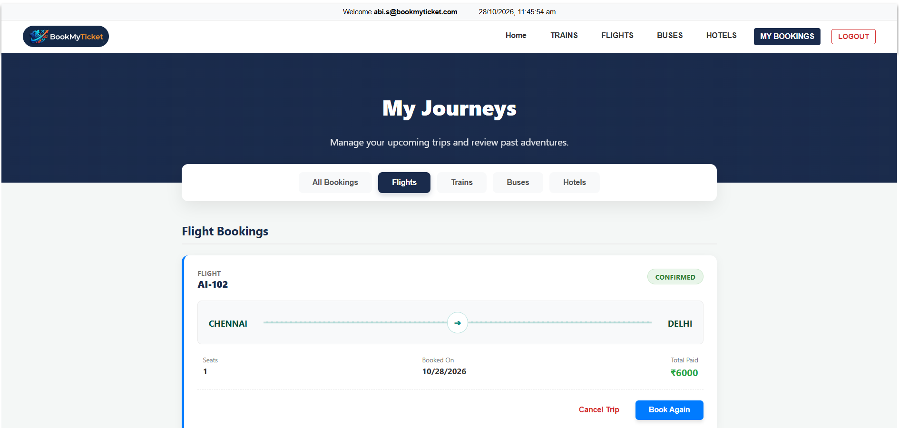

### 🛡️ Admin Portal

#### Platform Overview and Analytics

Review platform statistics, category-wise bookings, revenue summaries, and inventory counts.

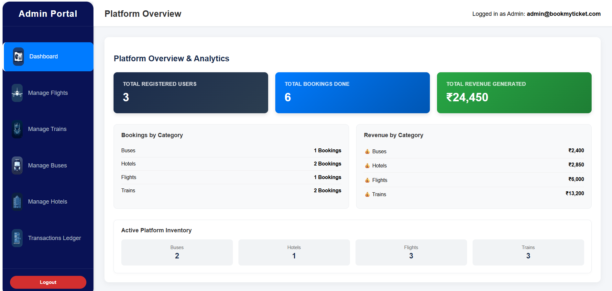

#### Flight Inventory Management

Review flight routes, departure information, prices, and available seats.

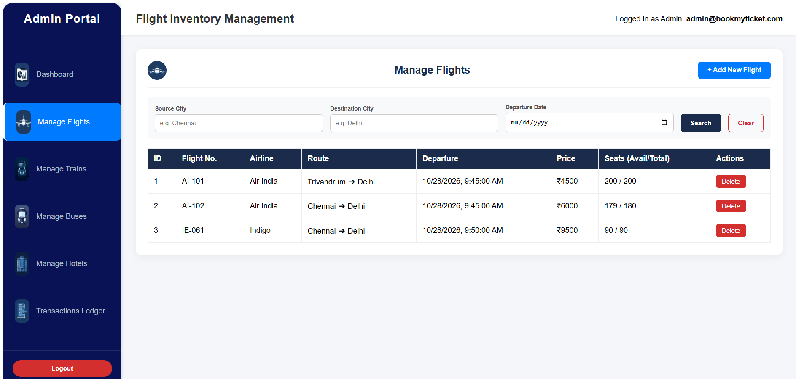

#### Train Inventory Management

Search and manage train inventory and schedules.

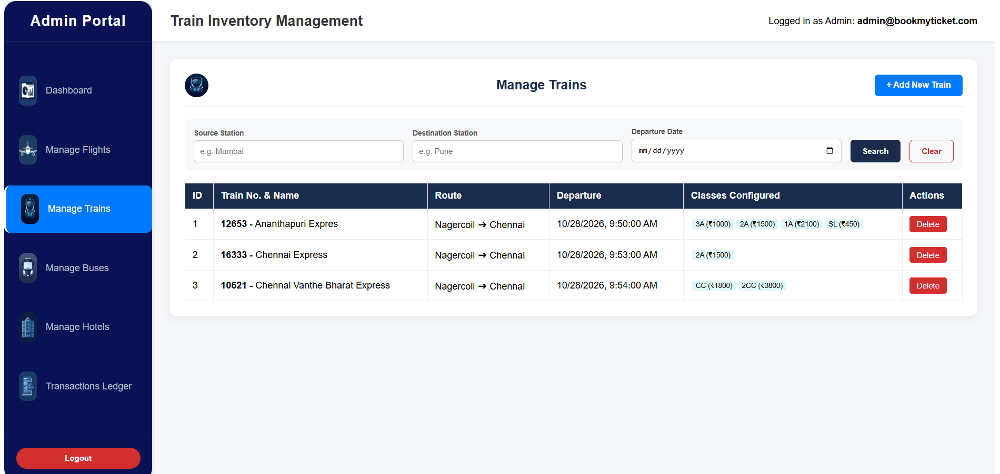

#### Bus Inventory Management

Manage bus routes, departure information, fares, and seat availability.

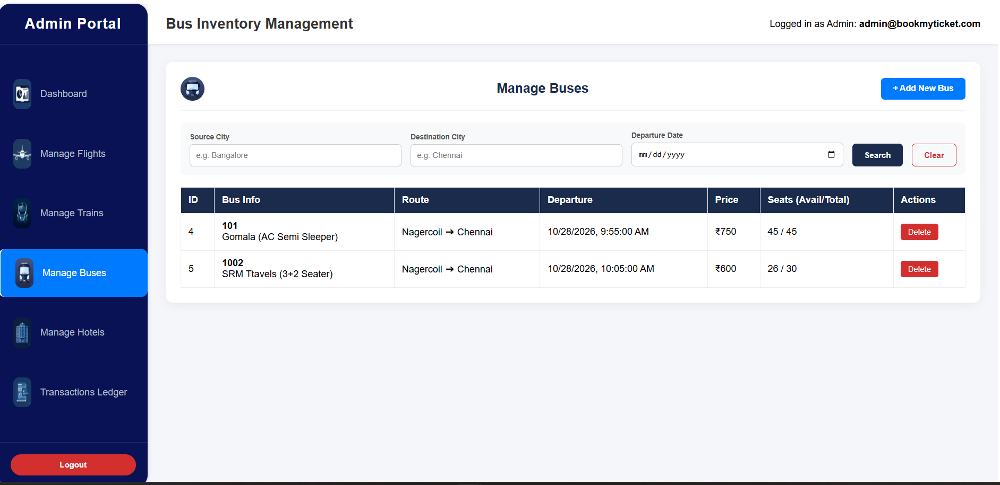

#### System Transactions Ledger

Review transactions across travel categories, including booking references, payment amounts, and statuses.

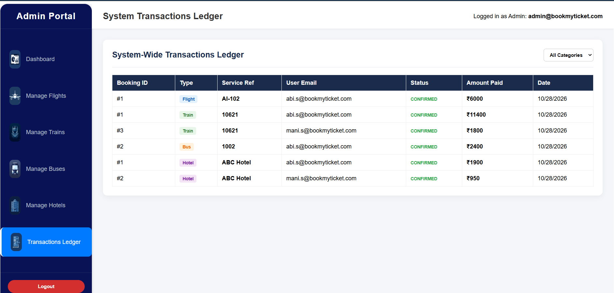

## 🏗️ Architecture

The application is organized into separate frontend and backend projects.

```text
BookMyTicket/
├── backend/
│   └── Book_My_Ticket/
│       ├── src/
│       ├── pom.xml
│       ├── mvnw
│       └── Dockerfile
├── frontend/
│   └── Book_My_Project/
│       ├── src/
│       ├── package.json
│       └── vite.config.js
├── docs/
│   └── screenshots/
└── README.md
```

### Backend Modules

| Module | Responsibility |
|---|---|
| `auth`, `security`, `config` | Authentication, JWT processing, and security configuration |
| `app_flight` | Flight inventory and flight-stop information |
| `app_train` | Train information, routes, and classes |
| `app_bus` | Bus inventory and route points |
| `app_hotel` | Hotel, room, and room-inventory management |
| `app_booking` | Booking workflows across travel categories |
| `app_payment` | Payment and transaction status management |
| `admin` | Administrative analytics and transaction access |
| `app_user` | Customer profile and dashboard functionality |

## ⚙️ Configuration and Deployment

### Environment Variables

Sensitive database credentials should be stored in environment variables rather than committed to source control.

The following is an example configuration. Ensure the variable names match your actual deployment settings.

```properties
spring.datasource.url=${DB_URL}
spring.datasource.username=${DB_USERNAME}
spring.datasource.password=${DB_PASSWORD}

spring.jpa.hibernate.ddl-auto=update
spring.jpa.show-sql=false
```

Configure `DB_URL`, `DB_USERNAME`, and `DB_PASSWORD` in the local environment or the backend hosting platform.

For production, use an appropriate schema migration strategy and disable unnecessary SQL logging.

### Docker

The backend uses a multi-stage Docker build to separate compilation from runtime.

```dockerfile
# Build stage
FROM maven:3-eclipse-temurin-27 AS build

WORKDIR /app
COPY pom.xml .
COPY src ./src

RUN mvn clean package -DskipTests

# Runtime stage
FROM eclipse-temurin:27-jre

WORKDIR /app
COPY --from=build /app/target/*.jar app.jar

EXPOSE 8080

ENTRYPOINT ["java", "-jar", "app.jar"]
```

This Dockerfile assumes that the backend produces an executable Spring Boot JAR and that the build context contains the specified `pom.xml` and `src` directory. Adjust the paths if your actual Dockerfile uses a different build context.

### Deployment

- **Frontend:** Deployed on Vercel.
- **Backend:** Deployed as a Docker web service on Render.
- **Database:** Managed MySQL 8.0 hosted on Aiven Cloud.
- **Configuration:** Environment variables used for deployment-specific settings.

## 🚀 Run Locally

### Prerequisites

- Java Development Kit compatible with the project
- Node.js and npm
- MySQL database
- Git

### 1. Clone the Repository

```bash
git clone https://github.com/Abinesh-S-7/Book-My-Ticket.git
cd BookMyTicket
```

> Replace the repository URL with your actual repository URL if the name or location differs.

### 2. Configure and Start the Backend

Open PowerShell:

```powershell
cd backend/Book_My_Ticket

$env:DB_URL="jdbc:mysql://localhost:3306/your_database"
$env:DB_USERNAME="your_username"
$env:DB_PASSWORD="your_database_password"

.\mvnw spring-boot:run
```

Replace the sample database connection details with your own MySQL configuration. Keep real credentials out of source control.

### 3. Start the Frontend

Open a separate terminal:

```bash
cd frontend/Book_My_Project
npm install
npm run dev
```

Open the local development URL printed by Vite in the terminal.

## 👨‍💻 Author

**Abinesh S.**

- [GitHub Profile](https://github.com/Abinesh-S-7)
- [LinkedIn Profile](https://www.linkedin.com/)

## 🌐 Try the Application

- **Frontend:** [BookMyTicket Live](https://bookmyticket-seven.vercel.app/)
- **Backend:** [BookMyTicket REST API](https://book-my-ticket-qwng.onrender.com/)

If the backend has been idle, allow extra time for the initial request while the service starts.

---

⭐ If you find this project interesting, feel free to explore the repository and its features.
